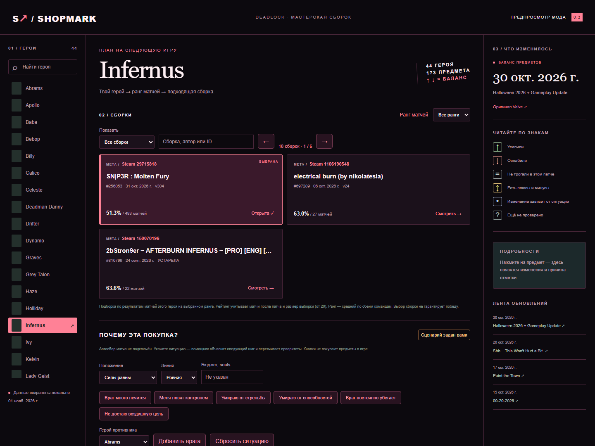
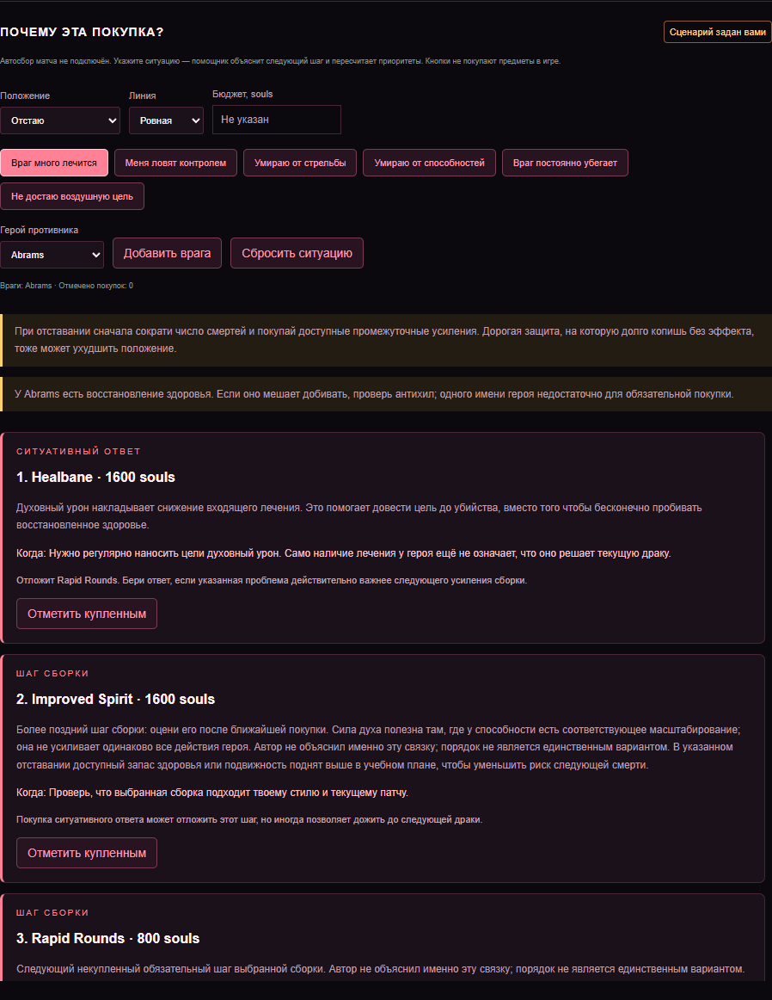

# Shopmark 0.3 — учебный помощник

> В этой ветке разрабатывается 0.4 с отдельным автопомощником. [Состояние интеграции и проверки](docs/AUTOMATIC.md). Работа полного цикла в матче пока не подтверждена; публичный релиз остаётся 0.3.

**Каталог сборок, заметные отметки патча и объяснения следующих покупок.**

В 0.3 появился учебный режим с пересчётом советов по явно заданному сценарию. **Полностью автоматический сбор состояния матча и изменение игровой расстановки предметов пока не реализованы.** Это предварительная версия, а не готовый автоматический тренер.

[Скачать 0.3](https://github.com/d1rtym0lly/shopmark/releases/tag/v0.3.0) · [Совместимость](docs/COMPATIBILITY.md)

## Новое в 0.3

- В каталоге 12–19 сборок для каждого из 44 героев, страницы и поиск по названию/автору/ID. Отдельный фильтр известных авторов. Доступность подтверждённых авторов неодинакова: от 1 до 12 на героя в текущем реестре; неподтверждённые имена не получают эту отметку.
- Мятные ↑, коралловые ↓ и сиреневые = в ярких круглых метках без мигания.
- «Разобрать сборку» открывает сценарий: преимущество/отставание, результат линии, бюджет, наблюдаемые угрозы, до шести героев противника и отметки уже купленных вещей.
- Советы показывают эффект по игровому описанию, продолжение рецепта, связь с предыдущей покупкой, условия контрпредмета и откладываемый шаг сборки. Без авторского объяснения не объявляют порядок доказанно оптимальным.

[Как устроены советы и что остаётся для автоматизации](docs/COACHING.md).

## Как пользоваться

1. Открой игровой браузер сборок и выбери того же героя в Shopmark.
2. Выбери ранг матчей или «Все ранги».
3. Листай каталог, используй поиск и сравни варианты: винрейт, число матчей и ID. Нажми «Найти», затем штатную кнопку «Использовать».

Ранг выбирается отдельно для каждого героя. Авторы остаются подписью источника сборки; про статус не влияет на подбор. Рекомендации считаются по ranked-матчам после даты показанного патча, минимум 20 игр. «Ранг матчей» — средний badge обеих команд из API, а не личный ранг каждого игрока. Нет достаточной выборки — нет заявления о проверенной мете. Сборка фиксируется API в начале матча; реальные покупки и победа могут зависеть от других факторов.

## Что изменилось в 0.2

- Отбор «герой × ранг» вместо приоритета про авторов; статистика всех авторов.
- Понятные основные фильтры, сохранение выбора ранга для героя в текущем окне, чёрно-коралловая тема.
- Исправлено сопоставление отметок с предметами: отображаемое имя на русском/английском вместо предположения о native CSS-классах. Повторно используемая карточка обновляет отметку при смене предмета.
- Убраны загромождающие карточки вопросы. Непроверенное изменение не подменяется знаком равенства.
- Штатные цветные изображения игры сохранены. Предпросмотр использует игровые shop_image через Assets API.

↑ — усиление, ↓ — ослабление, = — нет упоминания в проверенном разделе Items, ↕ — смешанные изменения, • — ситуативная переработка. Непроверенные отметки не показываются на карточках. Дата проверенного обзора видна в заголовке; это не обещание учёта всех скрытых или общих изменений.

## Установка

Скачай ZIP из релиза 0.2, извлеки shopmark.vpk и импортируй через Add Local Mod в Deadlock Mod Manager. **Отключи старую версию Shopmark**, чтобы два VPK не заменяли одни и те же файлы. Перезапусти игру.

Прямое локальное обновление разработчика: npm run install:mod. Только собственная предыдущая копия с ожидаемым SHA-256 заменяется с резервной копией; чужие моды и gameinfo.gi не перезаписываются. Если игра открыта, установщик останавливается.

## Проверка и разработка

Node.js 22+: npm ci, npm test, npm run test:ui. Предпросмотр: npm run preview, затем http://127.0.0.1:4173.

Обновление статистики: npm run sync. Кэш API — 6 часов; текущая дата обзора патча берётся из снимка. При новом патче сначала обновить/проверить каталог и data/patch-reviews.json (старый сборщик доступен как sync:legacy), затем повторить sync. Не представлять старые отметки как обзор нового патча.

Сборка: npm run build. Нужны CS2 Workshop Tools и Source 2 Viewer CLI 20.1. Пути: SHOPMARK_GAME, SHOPMARK_COMPILER, SHOPMARK_VIEWER. Выходы: dist/shopmark.vpk и build-manifest.json. Проверка: npm run doctor. Упаковка: powershell -File tools/package.ps1.

В игру поставляются короткие подборки и таблица имён, без HTTP-запросов и картинок. Отметки перечитывают короткое имя карточки раз в секунду, чтобы правильно обрабатывать её переиспользование движком. Игровой тест 0.3 пока не завершён; исправление воспроизведено и проверено тестом с отсутствующими native item-классами и сменой предмета.

Конфликтующие ресурсы: citadel_ui_build_selector.vxml_c, citadel_shop_mod_view.vxml_c, citadel_shop_mod_view_favorites.vxml_c. Полная совместимость со всеми UI-модами не заявляется.

Новая вкладка «Помощник» находится в браузере сборок. Совет не переставляет саму игровую сборку и не покупает предметы. Перед установкой отключить предыдущий Shopmark. Бинарная компиляция и тесты не заменяют проверку Panorama в игре.

## Источники

[Deadlock API](https://api.deadlock-api.com/docs) — статистика, сборки, каталог. Ручной обзор Items хранится вместе с источником в data/patch-reviews.json. Данные и изображения Deadlock принадлежат Valve. Оригинальный код — MIT. Проект не связан с Valve или авторами сборок.
