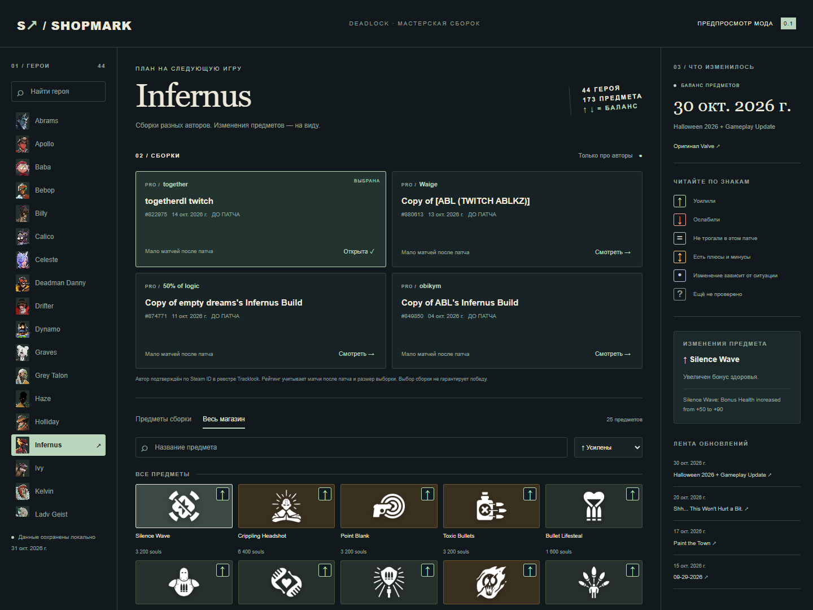

# Shopmark

Сборки разных про авторов и отметки баланса предметов в штатном магазине Deadlock.

**0.1.0 — предварительная сборка для проверки.** VPK скомпилирован для build 6839, проверены контрольные суммы и совпадение исходных ресурсов с установленной игрой. Проверка в игровом интерфейсе пока не завершена: тестовый запуск не получил соединение со Steam. Публикация в каталоги ещё не выполнялась.



## Что сделано

- Подборки для 44 доступных героев: до четырёх сборок разных авторов, переключение про/все авторы.
- Про авторы сопоставляются по числовому Steam account ID с [реестром Tracklock](https://tracklock.gg/probuilds/pros). Название сборки не подтверждает авторство; копия подписывается её действительным автором.
- Ранжирование учитывает свежесть, авторство и статистику ranked-матчей после последнего предметного патча: средний badge от 106, минимум 20 матчей, нижняя граница Wilson 95%. При отсутствии выборки используются доступные недельные избранные и дата обновления. Показатели не означают доказанную силу сборки: API фиксирует сборку в начале матча, фактические покупки могут отличаться.
- Пометки `ДО ПАТЧА` и `УСТАРЕЛА` для сборок, которым нужна перепроверка. На первом дне нового патча статистики часто мало.
- `↑` усиление, `↓` ослабление, `=` не упоминался в проверенном разделе Items, `↕` смешанные изменения, `•` ситуативное изменение, `?` нет проверки.
- Лента недавних обновлений и список изменений предметов на русском и английском. Оригинальные заметки сохранены на английском.
- Статические CSS-отметки без постоянного обхода дерева интерфейса. В игре нет HTTP-запросов, фонового таймера, стороннего сервера или дополнительных изображений.

## Использование в игре

1. Соберите VPK или возьмите локальный `dist/shopmark.vpk`.
2. Добавьте его как локальный мод в Deadlock Mod Manager, включите в отдельном тестовом профиле.
3. Откройте штатный браузер сборок героя.
4. В Shopmark выберите **того же героя**, автора и нажмите «Найти сборку».
5. Проверьте ID/автора в результатах и нажмите штатную кнопку «Использовать».
6. «Патчи и предметы» переключает подборки на ленту и объяснения отметок.

Передача ID в штатный поиск реализована, но ещё требует проверки в запущенной игре. Мод не переключает игрового героя. Автоматического применения сборки или покупок нет.

## Локальный просмотр и разработка

Нужен Node.js 22+; зависимости используются только для проверки предпросмотра.

```powershell
npm ci
npm test
npm run preview
```

Откройте http://127.0.0.1:4173 — интерактивный предпросмотр с реальными данными. Он показывает дизайн и поведение данных; внутриигровая вёрстка Panorama отличается. Изображения в предпросмотре загружаются с Deadlock API Assets.

```powershell
npm run sync
npm run build -- --game "C:\steam\steamapps\common\Deadlock\game\citadel" --compiler "C:\steam\steamapps\common\Counter-Strike Global Offensive\game\bin\win64\resourcecompiler.exe" --viewer "C:\Tools\Source2Viewer-CLI.exe"
npm run doctor
npm run test:ui
```

Для сборки нужен установленный CS2 Workshop Tools (`resourcecompiler.exe` и `csgo/bin/win64/modtools.dll`) и [Source 2 Viewer CLI 20.1](https://github.com/ValveResourceFormat/ValveResourceFormat/releases/tag/20.1). Укажите пути флагами или `SHOPMARK_GAME`, `SHOPMARK_COMPILER`, `SHOPMARK_VIEWER`. Компилятор создаёт ресурсы в `.build`, оригинальные `gameinfo.gi` и addons не изменяются. На Windows создаются junction-ссылки на установленные каталоги инструментов; не применяйте стороннюю рекурсивную очистку `.build`, переходящую по ссылкам.

`sync` использует [Deadlock API](https://api.deadlock-api.com/docs), кэш на 6 часов, таймауты и ограниченный параллелизм. `--refresh` обходит кэш. Ошибка загрузки сборок сохраняет предыдущий снимок; `--allow-partial` явно разрешает неполные данные. Статистика опциональна: её отсутствие показывается в карточке. После обновления данных пересоберите VPK и перезапустите игру. Внутри игры мод самостоятельно не обновляется.

## Отметки и проверка патчей

`data/patch-reviews.json` содержит проверенный раздел Items из официальной публикации, статусы и причины. Мод не выводит полезность из слова increased: увеличение cooldown является ослаблением, увеличение урона — усилением. Переработки оцениваются отдельно.

Новый или изменившийся раздел автоматически снимает доверие к старому обзору: вместо ложного `=` появляется `?`. Новые предметы, которых нет в снимке, также получают `?`. Знак `=` означает отсутствие упоминания именно в выбранном разделе Items, а не отсутствие всех косвенных эффектов общих изменений игры. Проверку обзора и полноты сопоставления нужно повторять после каждого предметного патча.

## Совместимость и выпуск

Мод заменяет три ресурса:

```text
panorama/layout/citadel_ui_build_selector.vxml_c
panorama/layout/citadel_shop_mod_view.vxml_c
panorama/layout/citadel_shop_mod_view_favorites.vxml_c
```

Моды, меняющие те же файлы, требуют объединения правок. Имена героев и предметов не захардкожены в логике, но структура штатного UI и движок могут меняться. `doctor` сравнивает SHA-256 исходных ресурсов и ищет пересечения в найденных addons/подключённых каталогах. Отсутствие обнаруженных пересечений не доказывает совместимость с каждым модом. См. [матрицу проверки](docs/COMPATIBILITY.md).

Для GameBanana/Deadlock Mod Manager подготовлены [текст карточки](docs/LISTING.md), скрипт упаковки и [список проверок релиза](docs/RELEASE.md). Отправка будет после проверки и доработок.

## Источники и права

[Deadlock API](https://api.deadlock-api.com/docs) — герои, предметы, сборки и статистика; [официальная публикация Valve](https://store.steampowered.com/news/app/1422450/view/680765564125186045) — обзор баланса 30 октября; Tracklock — реестр авторов. Отчёт о покрытии: `data/coverage.json`. В начальном сборе просмотрено 3106 сборок; в поставляемый снимок включено до 12 разных авторов на героя. 6 героям не хватило трёх авторов с обновлениями за 30 дней; альтернативы сообщества подписаны отдельно.

Оригинальный код Shopmark — MIT. Deadlock, ресурсы игры и изображения принадлежат Valve. Программа не связана с Valve, авторами сборок или Tracklock. Сторонние инструменты компиляции не включены в репозиторий.
